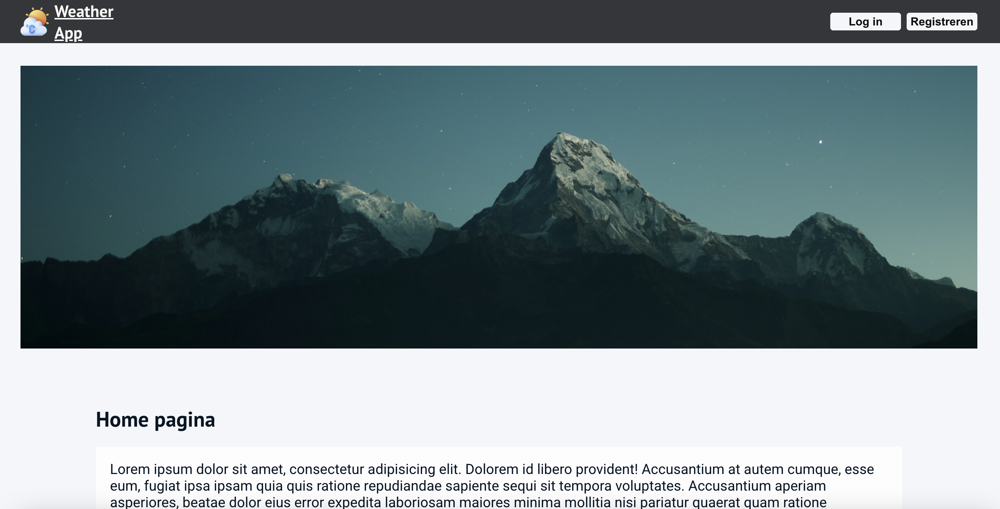
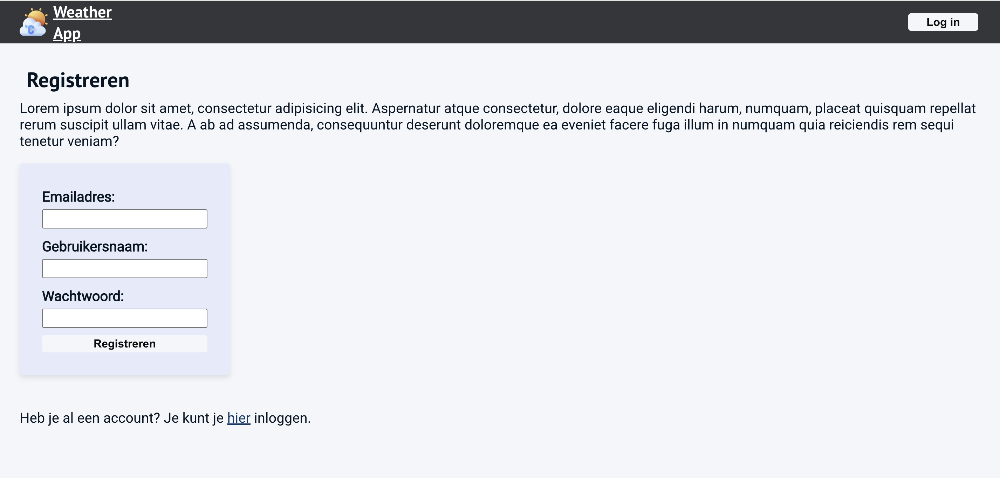
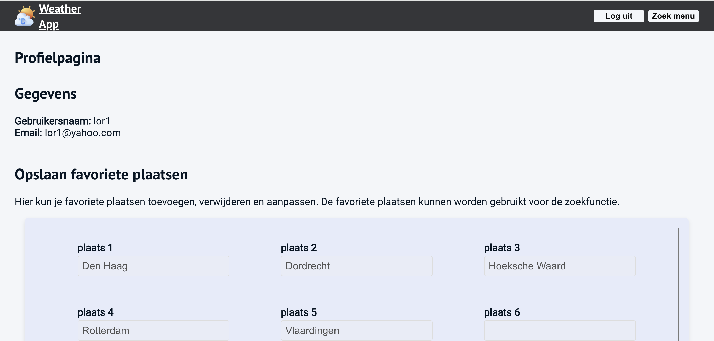
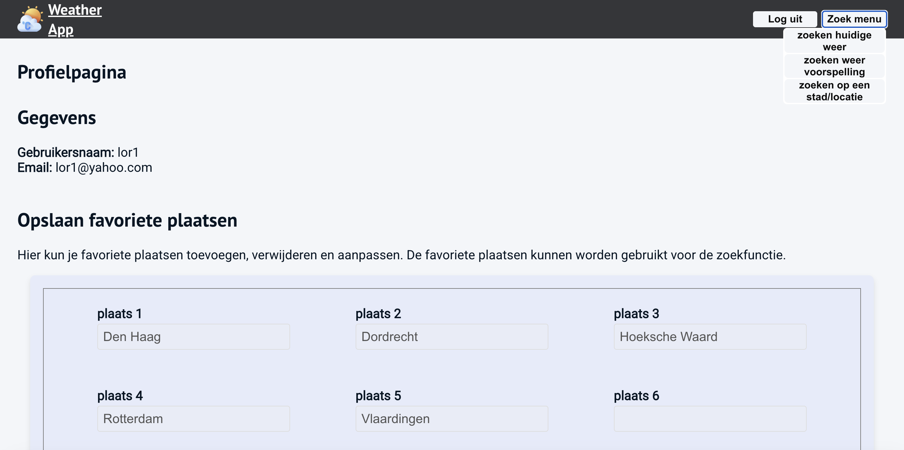
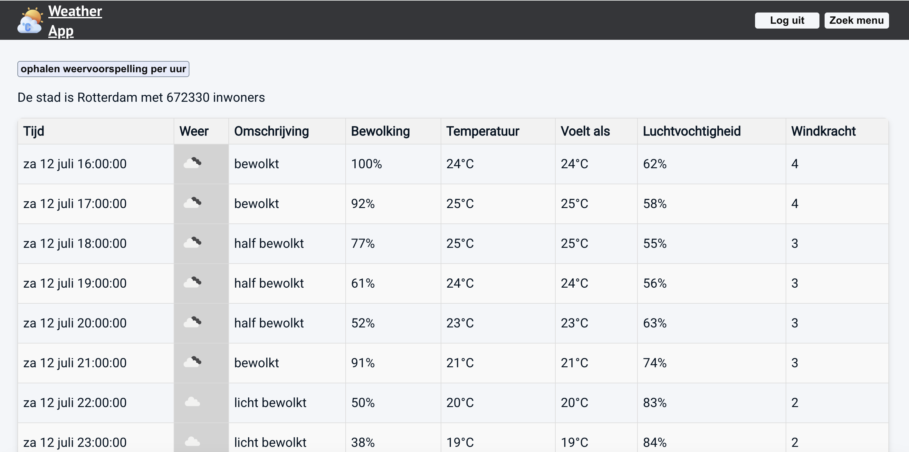
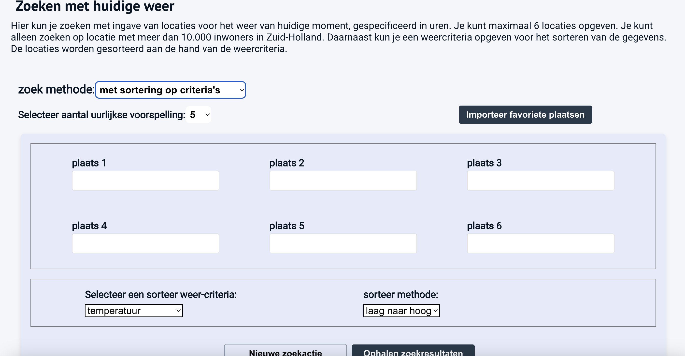
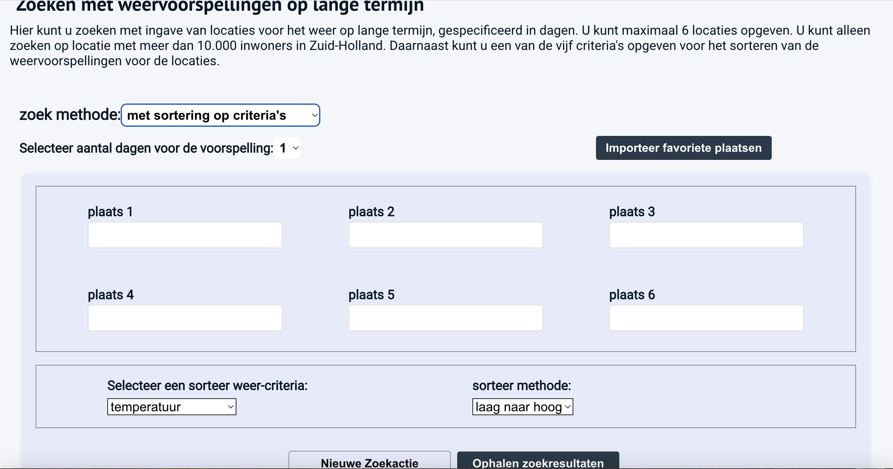
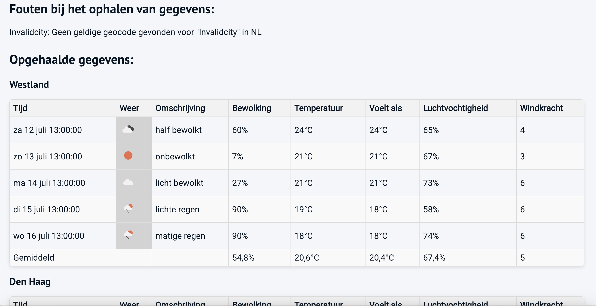

# Weather Application - Handleiding

## Inleiding

Ik woon zelf in Rijswijk (Den Haag). Veel mensen willen in hun vrije tijd iets leuks gaan doen,
zonbaden, surfen, zeilen, wandelen etc. Daarvoor is het nodig om te kijken welke
weeromstandigheden er zijn, zodat zij een goede overweging kunnen maken naar welke locatie zij
kunnen gaan die optimaal is voor hun activiteit. Ik heb zelf de provincie Zuid-Holland genomen als
regio waarop mensen/gebruikers kunnen zoeken voor een geschikte locatie/stad. De steden die zij kunnen 
invoeren zijn steden die een inwoners aantal hebben van boven de 10.000. Ik wil later deze applicatie uitbreiden
voor plaatsen in heel Nederland en ook kleinere plaatsen, maar voor nu is het alleen gericht op de provincie Zuid-Holland met grotere plaatsen.

In de applicatie kunnen gebruikers meerdere steden kiezen/invoeren waarvan zij de weersverwachtingen te weten willen komen.
Daarnaast kunnen zij de steden/plaatsen ordenen op basis van de temperatuur, windkracht, luchtvochtigheid of bewolking. 
Verder is het ook mogelijk om favoriete plaatsen op te slaan, zodat zij bij volgende bezoek op de website door een druk 
op een knop de plaatsen kunnen importeren. De gebruikers kunnen weersvoorspellingen opzoeken voor per uurlijks of per dagelijks. 
Hierdoor kunnen zij een planning maken voor hun activiteiten op korte termijn (huidige dag) of lange termijn (meerdere dagen).



## Applicatie inrichten

De applicatie kan worden gedraaid in React van Webstorm. Daarom heb je Webstorm nodig om deze applicatie te draaien.
Clone eerst de [Weather Application project](https://github.com/LorensZhou/frontend-weather-application) naar jouw lokale machine.
Als je de dependencies nog niet hebt geïnstalleerd, kun je dat eerst doen met het commando:

```shell
npm install
```
Het is belangrijk dat een file genaamd `.env` aanwezig is in de root van het project. 
Deze file bevat de API-sleutel voor de OpenWeatherMap API. 
Daarom moet je een nieuwe file aanmaken in de root van het project met de naam `.env` (ter hoogte van bijv. vite.config.js) 
en daarin de volgende regel toevoegen:

```plaintext
zie readme-file van de map project Weather Application
```


Vervolgens kun je de file .env initialiseren door het volgende commando in jouw terminal in te voeren:

```shell
npm run build
```

Daarna is het belangrijk dat je Axios package installeert, omdat deze package wordt gebruikt voor het maken van HTTP-verzoeken naar de OpenWeatherMap API en de backend voor de aunthenticatie server.
Je kunt Axios installeren door het volgende commando in jouw terminal in te voeren:

```shell
npm install axios
```

## Applicatie starten

Om de applicatie van het project te starten hoef je slechts het volgende commando in jouw terminal in te voeren:

```shell
npm run dev
```
In de terminal zie je dat de applicatie draait op `http://localhost:5173/`. Als je deze link kopieert en paste in de browser 
adresbalk, dan kom je bij de applicatie terecht. Je kunt ook op deze link dubbelklikken dan opent de applicatie in je standaard browser.
Je komt dan op de homegage. Ik heb voor de backend Heroku server gebruikt voor authentificatie en verificatie. 
Daarom is het nodig om eerst een gebruiker account eerst aan te maken, want op de server worden accounts om de uur geleegd.
Door op de knop "Registreren" te klikken, kun je een account aanmaken. Zie screenshot hieronder:



Het invullen van de gebruikersnaam, email en wachtwoord is verplicht. Verder is het vereist dat het aantal karakters 
voor het wachtwoord minimaal 6 moet zijn. Na het invullen van de gegevens en klikken op de knop "Registreren".
Daarna kom je in de inlogpagina terecht. En kun je inloggen met je gebruikersnaam en wachtwoord. Vervolgens wordt je gestuurd naar 
de profielpagina. Op de profielpagina kun je maximaal 6 favoriete plaatsen opgeven die je kan gebruiken om bij de zoekfunctie te importeren. Als je ingelogd bent, 
dan pas kun je gebruikmaken van de zoekfuncties van weersvoorspellingen 
in het menu "Zoek menu". **Let op: Ik heb voor mijn applicatie de Heroku server gebruikt als back end voor de login en registratie. 
Het kan zijn als je meer dan een uur aan het testen bent, je eruit kan worden gegooid. 
Want de Heroku server leegt steeds om de uur de gebruikers gegeven. Hierdoor zijn de account gegevens weer verwijderd.
Dus na een uur moet je weer een account aanmaken en opnieuw inloggen.**
Zie screenshot hieronder:



Als je op de knop rechtsboven "Zoek menu" klikt, verschijnt drie knoppen waarop je kan zoeken naar weersvoorspellingen:



De drie zoekfuncties zijn:

1. **Zoeken per plaats**: hier kun je een plaatsnaam opzoeken en de weersvoorspelling voor die plaats bekijken.
2. **zoeken huidige weer**: De voorspellingen zijn uurlijks. Dat is alleen voor de huidige dag. Je maximaal 6 plaatsen invullen. Sortering is mogelijk 
3. **zoeken weer voorspelling**: De voorspellingen opzoeken voor per dag. Dus voorspellingen zijn voor meerdere dagen. Ook hier kun je maximaal 6 plaatsen invullen.  Sortering is mogelijk.

### 1. Zoeken per plaats

Bij het selecteren van deze zoekfunctie, krijg je een lijst van plaatsen te zien die in de provincie Zuid-Holland liggen 
met meer dan 10.000 inwoners. Als je op een plaats klikt, dan kom je op de pagina van die plaats terecht. 
Als je op de knop "ophalen weersvoorspellingen per uur" klikt, dan krijg je de weersvoorspellingen te zien voor die plaats per uur.




### 2. Zoeken huidige weer

Bij deze pagina kunnen je zoeken naar weersvoorspellingen op uurlijkse basis. Je kunt maximaal 6 plaatsen invoeren 
en de plaatsen worden gesorteerd op basis van een bepaalde weercriteria. Het is wel belangrijk dat je 
eerst kiest of je de plaatsen wilt gan sorteren of niet. Daarna kun je pas de plaatsen opgeven en de sorteringscriteria opgeven
Je kunt ook aangeven hoeveel uren voorspellingen je wilt zien. Verder is het mogelijk om de favoriete plaatsen te importeren. 
Zie screenshot hieronder:



### 3. Zoeken weer voorspelling

Bij deze functie kun je zoeken naar weersvoorspellingen op dagelijkse basis. Je kunt ook maximaal 6 plaatsen invoeren en 
de plaatsen worden gesorteerd op basis van een bepaalde weercriteria. Net als bij de vorige functie is het belangrijk dat je
eerst kiest of je de plaatsen wilt gaan sorteren of niet. Daarna kun je pas de plaatsen opgeven en de sorteringscriteria opgeven
Je kunt ook aangeven hoeveel dagen voorspellingen je wilt zien. Verder is het ook mogelijk om de favoriete plaatsen te importeren.
Zie screenshot hieronder:



Hieronder is er ook een screenshot als een voorbeeld van de voorspellingen die wij hebben opgehaald bij de zoekfunctie van dagelijkse voorspellingen.



Meestal gaat het wel goed, dan krijg je geen foutmeldingen dat een plaats niet wordt herkend. Want bij 
het invullen van de plaatsen wordt er een selectie weergegeven van de plaatsen die in de provincie Zuid-Holland liggen.
Als je een plaats selecteert, dan wordt die plaats in het invoerveld ingevuld. Daardoor kunnen geen verkeerde plaatsen 
in het invoerveld terecht komen. Soms kan zijn dat bij snel selecteren dat de plaats niet goed wordt geselecteerd. Daardoor 
wordt er alleen een karakter in het invoerveld geplaatst. Hierdoor zal het systeem zeggen dat de opgegeven plaatst
niet wordt herkend. In dat geval geeft het systeem een foutmelding. Bij het ingeven van twee dezelfde plaatsen wordt 
er alleen een tabel getoond van een plaats en niet van twee dezelfde plaatsen. Want de lijst van plaatsen wordt altijd 
gefilterd op unieke plaatsen.

